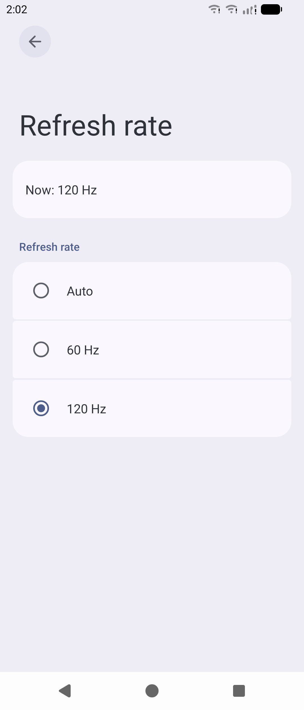
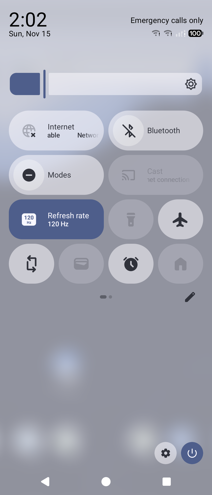

# Refresh Rate Switcher

A small system app for AOSP (Android 16+) to pick the display refresh rate from
**Settings -> Display** or a **Quick Settings tile**.

<table>
  <tr>
    <th>Refresh rate screen</th>
    <th>Quick Settings tile</th>
  </tr>
  <tr>
    <td align="center">
      
    </td>
    <td align="center">
      
    </td>
  </tr>
</table>

## Features

- Every refresh rate the panel supports, plus Auto
- Settings-style UI (SettingsLib, expressive theme)
- Quick Settings tile that shows the selected and the actual rate
## How it works

The app writes `min_refresh_rate` and `peak_refresh_rate` to `Settings.System`
(the keys behind "Smooth display"). A forced rate sets both to the same value,
Auto sets min to `0` and peak to the highest rate.

These keys can only be written by the system, so the app uses
`android:sharedUserId="android.uid.system"` and is signed with the platform key.

## Build

Put the project in your tree, for example `vendor/oss/RefreshRateSwitcher`,
and add it to your product:

```
PRODUCT_PACKAGES += RefreshRateSwitcher
```

## License

MIT, see LICENSE.
